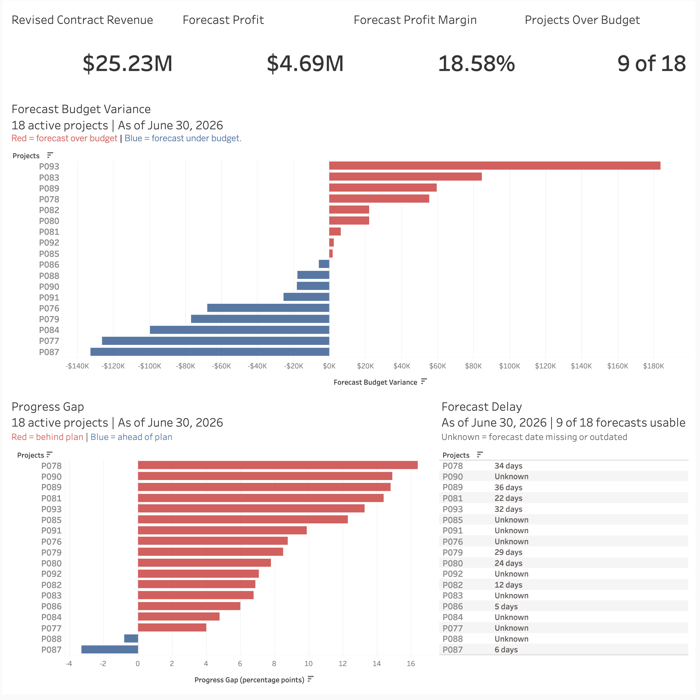

# Construction Profitability and Schedule-Risk Analysis

## Overview
- The leadership team needs a cross-project view of profitability and schedule performance to identify which active projects need management attention, investigate potential risk drivers, and inform future estimating and planning.
- I used DuckDB and SQL to clean, validate, and analyze project budgets, costs, labor entries, progress updates, and change orders, then built a Tableau Public dashboard to communicate the findings.
- The analysis recommends priority project reviews and specific follow-up actions based on forecast budget overruns, schedule concerns, and reporting limitations.

## Tools Used
- **DuckDB / SQL:** Profiled, cleaned, validated, and analyzed the data.
- **Tableau Public:** Built an interactive dashboard showing project profitability, forecast budget overruns, and schedule risk.
- **Excel:** Created a budget-versus-actual spreadsheet for reviewing costs by project and cost category.

## Key Findings
- The 18 active projects forecast $4.69M in total profit on $25.23M in revised contract revenue, with a portfolio forecast margin of 18.58%.
- Nine of the 18 active projects forecast budget overruns, although all 18 still forecast positive profit.
- Nine of the 18 active projects have Unknown finish delays: eight forecasts are outdated and one is missing. Unknown does not mean on schedule.

## Dashboard and Report
- [View the interactive Tableau dashboard](https://public.tableau.com/app/profile/william.olschewski/viz/construction_risk_dashboard_2026-06-30/ActiveProjectRisk)
- [Read the final report](docs/final_report.md)

## How to Run

### Requirements
- DuckDB
- Visual Studio Code with the DuckDB extension, or another interface capable of running DuckDB SQL

### Setup
1. Download or clone this repository.
2. Confirm that the six source CSV files are in `data/raw/`:
   - projects.csv
   - project_budgets.csv
   - cost_transactions.csv
   - labor_entries.csv
   - project_updates.csv
   - change_orders.csv
3. Open the repository’s root folder as your working directory so relative paths resolve correctly.
4. Use the same DuckDB connection throughout the workflow.

### Run the SQL
Run each script from top to bottom.

1. **Profile the source data:** Run scripts `01`–`06` to inspect the raw datasets.
2. **Create the cleaned data layers:** Run scripts `07`, `08`, `09`, `11`, `12`, and `13`.
3. **Reconcile change orders and budgets:** Run `sql/14_change_order_budget_reconciliation.sql` to compare approved change-order cost estimates with supplied budget adjustments.
4. **Build the analytical layer:** Run `sql/15_project_analytical_layer.sql` to create and validate `construction.project_summary`.
5. **Create the budget-versus-actual report:** Run `sql/10_budget_vs_actual_report.sql` to create the category-level report, reconcile incurred costs against the project summary, and export the report to CSV.
6. **Run the analysis:** Run `sql/16_project_analysis.sql`.
7. **Export dashboard data:** Run `sql/17_dashboard_exports.sql`.

The reporting cutoff is June 30, 2026. The main analysis covers 18 active projects; on-hold projects are reviewed separately in the analysis script.

### View the Results
- [Read the final report](docs/final_report.md).
- Open the interactive Tableau Public dashboard using the link above.
- Review the exported files in `outputs/`.